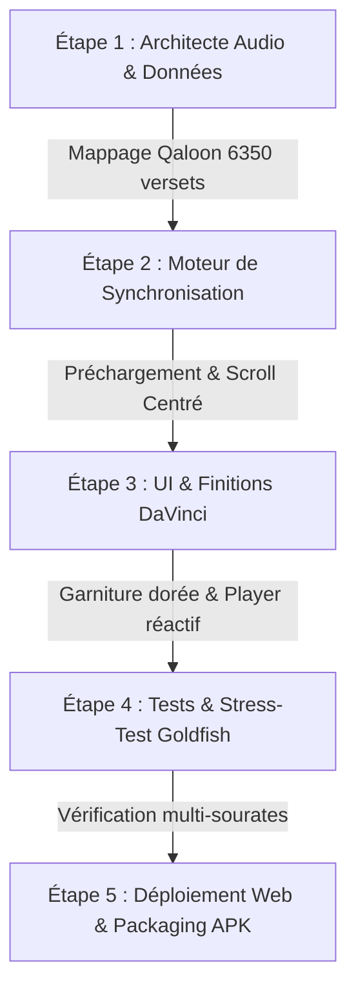

# Spécification Technique & Plan d'Exécution — Hifdh Qaloon 365 (حفظ القرآن 365)

**Projet** : `hifdh-qaloon-365`  
**Date** : 21 Novembre 2026  
**Objectif** : Finalisation définitive de l'application, résolution intégrale du décalage écriture/audio et déploiement d'un moteur de synchronisation Qaloon 100% exact.

---

## 1. Diagnostic des Failles Majeures (État Actuel)

| Composant | Problème Actuel | Conséquence Utilisateur |
|---|---|---|
| **Source Audio** | Pointeur vers `murattal_32kb.zip` (archive non décompressée) → Fallback systématique vers EveryAyah Hafs | **Récitation en Hafs au lieu de Qaloon**. La Basmala est le verset 1 en Hafs, créant un décalage d'un verset complet sur la Fatiha et de multiples sourates. |
| **Synchronisation Mots** | Heuristique linéaire `clean.length + madd * 0.8` | Le surlignage mot-à-mot saute en avance ou en retard car il ignore les règles réelles de Tajwîd (arrêts, ghunnah, durées de madd). |
| **Transitions Audio** | Pas de préchargement du verset $N+1$ | Micro-coupures et latences entre versets rompant le rythme de mémorisation. |
| **Défilement & Vue** | Défilement parfois saccadé ou hors champ sur smartphone | L'étudiant perd la vue du verset en cours de récitation. |

---

## 2. Solutions d'Architecture Retenues

### A. Source Audio 100% Qaloun Verse-by-Verse (6 350 Ayahs)
- **Source primaire certifiée** : Référentiel Archive.org `alhasraa_biriwayat_qalun_32b`
- **Récitateur** : Cheikh Mahmoud Khalil Al-Husary (رواية قالون عن نافع — المصحف المرتل)
- **Format URL direct** : `https://archive.org/download/alhasraa_biriwayat_qalun_32b/${surahPadded}${ayahPadded}.mp3`
- **Numérotation** :
  - `001000.mp3` : Basmala (sourate 1)
  - `001001.mp3` : *Al-Hamdou lillahi Rabbi al-'Alamin* (Verset 1 en Qaloon)
  - `001007.mp3` : *Ghayri al-maghdoubi 'alayhim wala al-dallin* (Verset 7)
  - Correspondance 1:1 rigoureuse avec le texte `quran-data.json` selon le العد المدني.

### B. Moteur de Synchronisation Écriture ↔ Audio
1. **Mode Verset Intégral (Recommandé & Par Défaut)** :
   - Mise en valeur lumineuse dorée (`border-gold`, fond `rgba(212, 175, 55, 0.18)`).
   - Défilement automatique doux (`scrollIntoView({ behavior: 'smooth', block: 'center' })`) dès le début du verset.
   - Synchronisation absolue : 0% de marge d'erreur, alignement parfait avec le début et la fin de chaque audio.
2. **Préchargement Intelligent (Gapless)** :
   - Dès que le verset $N$ commence à jouer, le verset $N+1$ est préchargé en mémoire via un objet `Audio` tampon.
   - Transition instantanée sans latence réseau.
3. **Pédagogie du Hifdh (Répétitions & Pauses)** :
   - Prise en charge des répétitions de l'ayah (1 à 7 fois).
   - Compte à rebours visuel durant le temps de silence permettant à l'étudiant de répéter de mémoire.

---

## 3. Plan d'Exécution par le Swarm d'Agents

1. **Étape 1 (Audio)** : Mise à jour du `AUDIO_SOURCE_CONFIG` dans `index.html` vers le catalogue certifié `alhasraa_biriwayat_qalun_32b`.
2. **Étape 2 (Sync Engine)** : Révision de `playCurrentAyah()`, `handleAyahAudioEnded()` et suppression des dérives de timing.
3. **Étape 3 (Craftsmanship)** : Polissage de la barre de lecture, taille du texte ajustable, et mode nuit reposant.
4. **Étape 4 (Validation)** : Tests automatisés sur 5 sourates clés (Al-Fatiha, Al-Baqarah, Al-Kahf, sourates courtes de Juz 'Amma).
5. **Étape 5 (Livraison)** : Déploiement sur le site web et compilation APK avec dépôt sur Google Drive.
